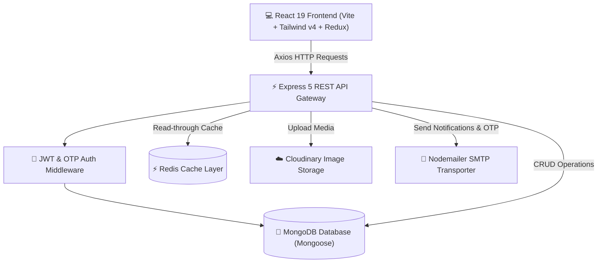

<div align="center">

# 🎓 CampusBaazar
### *The Next-Generation Campus-Exclusive Peer-to-Peer Marketplace*

[](https://github.com/nitin-code6/CampusBaazar/stargazers)
[](https://github.com/nitin-code6/CampusBaazar/network/members)
[](https://nodejs.org/)
[](https://react.dev/)
[](https://expressjs.com/)
[](https://www.mongodb.com/)
[](https://redis.io/)
[](https://tailwindcss.com/)
[](https://opensource.org/licenses/ISC)

<br/>

<p align="center">
  <strong>CampusBaazar</strong> is a high-performance, full-stack campus commerce ecosystem designed to help college students buy and sell secondhand essentials—ranging from academic textbooks and lab equipment to electronics and hostel furniture. Eliminating shipping fees, transit wait times, and third-party commissions by enabling instant on-campus exchanges.
</p>

<p align="center">
  <a href="#-key-features">Key Features</a> •
  <a href="#-system-architecture">Architecture</a> •
  <a href="#-tech-stack">Tech Stack</a> •
  <a href="#-api-endpoints">API Reference</a> •
  <a href="#-getting-started">Getting Started</a> •
  <a href="#-author">Author</a>
</p>

</div>

---

## 📌 Problem & Solution

| ⚠️ The Problem | 💡 The CampusBaazar Solution |
| :--- | :--- |
| **Expensive Shipping & Long Wait Times:** Traditional e-commerce charges heavy delivery fees and takes days to deliver. | **Zero Delivery Fee & Instant Handover:** Deals take place directly inside the college campus between verified peers. |
| **Graduating Senior Waste:** Graduating students abandon textbooks, bicycles, and furniture they can no longer carry. | **Circular Campus Economy:** Junior students purchase pre-loved items at affordable, student-friendly prices. |
| **Scams & Trust Issues:** Unverified strangers on open marketplaces create safety concerns for students. | **College Email & OTP Authentication:** Only authenticated college community members can transact and review. |

---

## 🚀 Key Features

### 🔐 1. Authentication & Security
- **JWT & HTTP-Only Cookies:** Secure stateless sessions with protected token verification.
- **OTP Verification via Nodemailer:** Email verification during registration to guarantee authenticated campus identities.
- **Bcrypt Password Encryption:** Industry-standard password hashing with custom salt rounds.

### 🛍️ 2. Peer-to-Peer Marketplace & Catalog
- **Multi-Category Directory:** Organized browsing across *Books, Electronics, Stationery, Instruments, Hostel Essentials, and Sports Gear*.
- **Live Search & Dynamic Filtering:** Real-time query matching by title, tags, condition, and price ranges.
- **High-Definition Image Uploads:** Multi-file product image uploads powered by **Multer** and delivered through **Cloudinary CDN**.

### 👥 3. Multi-Tier Role-Based Access Control (RBAC)
- **Student Buyer:** Search items, add to cart, place orders, and manage order history.
- **Student Seller / Admin:** Post listings, edit inventory, manage pricing, and verify purchase requests.
- **SuperAdmin:** Platform-wide oversight to moderate listings, approve seller requests, and manage user accounts.

### 🛒 4. Cart & Order Lifecycle
- **Persistent Cart State:** Synchronized through **Redux Toolkit** and backed by database persistence.
- **Sliding Cart Drawer:** Modern slide-out drawer UI for frictionless checkout without leaving the browse view.
- **Order Tracking:** Real-time statuses (`Pending`, `Approved`, `Delivered`, `Cancelled`).

### ⚡ 5. Performance & Caching
- **Redis In-Memory Cache:** Fast caching layer for hot product categories and frequent queries to keep response latencies sub-second.
- **Tailwind CSS v4 + Glassmorphism:** Sleek, responsive, mobile-first design with smooth micro-interactions.

---

## 🏗️ System Architecture



---

## 🛠️ Tech Stack

<div align="center">

| Layer | Technologies |
| :--- | :--- |
| **Frontend Framework** | **React 19**, **Vite 7**, **React Router v7** |
| **State Management** | **Redux Toolkit (RTK)** |
| **Styling & Icons** | **Tailwind CSS v4**, **PostCSS**, **Lucide React** |
| **Backend Runtime** | **Node.js (v18+)**, **Express.js (v5.2)** |
| **Database & ODM** | **MongoDB**, **Mongoose** |
| **Caching Layer** | **Redis (In-Memory Data Store)** |
| **Cloud Storage** | **Cloudinary CDN** (via Multer Disk/Memory Storage) |
| **Email Services** | **Nodemailer (Gmail SMTP / Custom Host)** |
| **Security & Validation** | **JWT**, **Bcrypt.js**, **Validator**, **Zod** |

</div>

---

## 📂 Project Directory Structure

```text
CampusBaazar/
├── 📁 Backened/                     # Express.js REST API Server
│   ├── 📁 src/
│   │   ├── 📁 config/              # MongoDB, Redis & Cloudinary configs
│   │   ├── 📁 controllers/         # Request handling & business logic
│   │   ├── 📁 middlewares/         # JWT Auth, Role verification, Multer upload
│   │   ├── 📁 models/              # Mongoose data schemas (Person, Product, Order, Cart)
│   │   ├── 📁 routes/              # Express API route declarations
│   │   ├── 📁 Utility/             # OTP generator, Nodemailer & input validators
│   │   └── 📄 server.js            # Express application bootstrap
│   ├── 📄 package.json
│   └── 📄 .gitignore
│
├── 📁 Frontend/                     # React 19 Client Application (Vite)
│   ├── 📁 public/                  # Static assets and favicons
│   ├── 📁 src/
│   │   ├── 📁 assets/              # Logos and SVG illustrations
│   │   ├── 📁 components/          # Reusable UI (Header, Footer, ProductCard, CartDrawer)
│   │   ├── 📁 pages/               # Views (Home, Shop, AddProduct, Orders, Profile, Admin)
│   │   ├── 📁 store/               # Redux Toolkit global store configuration
│   │   ├── 📁 utility/             # Axios instance & HTTP interceptors
│   │   ├── 📄 App.jsx              # Application router setup
│   │   ├── 📄 index.css            # Tailwind CSS v4 styling rules
│   │   └── 📄 main.jsx             # React entrypoint
│   ├── 📄 vite.config.js           # Vite build configuration
│   └── 📄 package.json
│
├── 📄 .gitignore                    # Root repository ignore rules
└── 📄 README.md                     # Comprehensive project documentation
```

---

## 🔌 API Endpoints Overview

| Method | Endpoint | Description | Access |
| :--- | :--- | :--- | :--- |
| `POST` | `/api/v1/auth/register` | Register new student account with OTP | Public |
| `POST` | `/api/v1/auth/login` | Login and issue authentication token | Public |
| `POST` | `/api/v1/auth/verify-otp` | Verify email OTP code | Public |
| `GET` | `/api/v1/products` | Fetch all campus product listings | Public |
| `POST` | `/api/v1/products/create` | Create new product listing with image | User / Seller |
| `PUT` | `/api/v1/products/:id` | Update product details or mark sold | Seller / Admin |
| `DELETE` | `/api/v1/products/:id` | Remove a product listing | Seller / SuperAdmin |
| `GET` | `/api/v1/cart` | Retrieve user active cart items | Authenticated |
| `POST` | `/api/v1/cart/add` | Add product to shopping cart | Authenticated |
| `POST` | `/api/v1/orders/place` | Place an on-campus order | Authenticated |
| `GET` | `/api/v1/orders/my-orders` | View user order history | Authenticated |
| `GET` | `/api/v1/admin/requests` | Review seller verification requests | SuperAdmin |

---

## ⚡ Getting Started

### 📋 Prerequisites
Ensure you have the following installed locally:
- [Node.js](https://nodejs.org/) (version `18.0.0` or higher)
- [MongoDB](https://www.mongodb.com/) (Local instance or MongoDB Atlas cluster)
- [Redis](https://redis.io/) (Local daemon or Redis Cloud)
- [Cloudinary Account](https://cloudinary.com/) (Free tier for media uploads)

---

### 1️⃣ Clone the Repository
```bash
git clone https://github.com/nitin-code6/CampusBaazar.git
cd CampusBaazar
```

---

### 2️⃣ Backend Configuration & Startup
```bash
# Navigate to Backened directory
cd Backened

# Install dependencies
npm install

# Create environment configuration
cp .env.example .env   # Or create .env manually
```

Add your environment variables inside `Backened/.env`:
```env
PORT=8000
MONGO_URI=mongodb+srv://<username>:<password>@cluster.mongodb.net/campusbaazar
JWT_SECRET=your_jwt_super_secret_key_12345
CLOUDINARY_CLOUD_NAME=your_cloudinary_cloud_name
CLOUDINARY_API_KEY=your_cloudinary_api_key
CLOUDINARY_API_SECRET=your_cloudinary_api_secret
REDIS_URL=redis://127.0.0.1:6379
EMAIL_USER=nitbit710@gmail.com
EMAIL_PASS=your_google_app_password
```

Start the backend server:
```bash
npm run start
```
> Server running at: `http://localhost:8000`

---

### 3️⃣ Frontend Configuration & Startup
```bash
# In a new terminal tab, navigate to Frontend
cd Frontend

# Install dependencies
npm install

# Start Vite development server
npm run dev
```
> Client running at: `http://localhost:5173`

---

## 👨‍💻 Author

<div align="center">

**Nitin Kumar**  
*Full Stack Developer*

[](https://github.com/nitin-code6)
[](https://linkedin.com)
[](mailto:nitbit710@gmail.com)

</div>

---

## 📈 Roadmap & Upcoming Features
- [ ] 💬 Real-Time In-App WebSocket Chat between buyers & sellers.
- [ ] 🔔 Push notifications for order status transitions.
- [ ] 📍 Campus hostel room delivery coordinate pinpoints.
- [ ] 🤖 AI-powered price estimator based on product age and condition.

---

## ⚖️ License
This project is open-source and licensed under the [ISC License](https://opensource.org/licenses/ISC).
